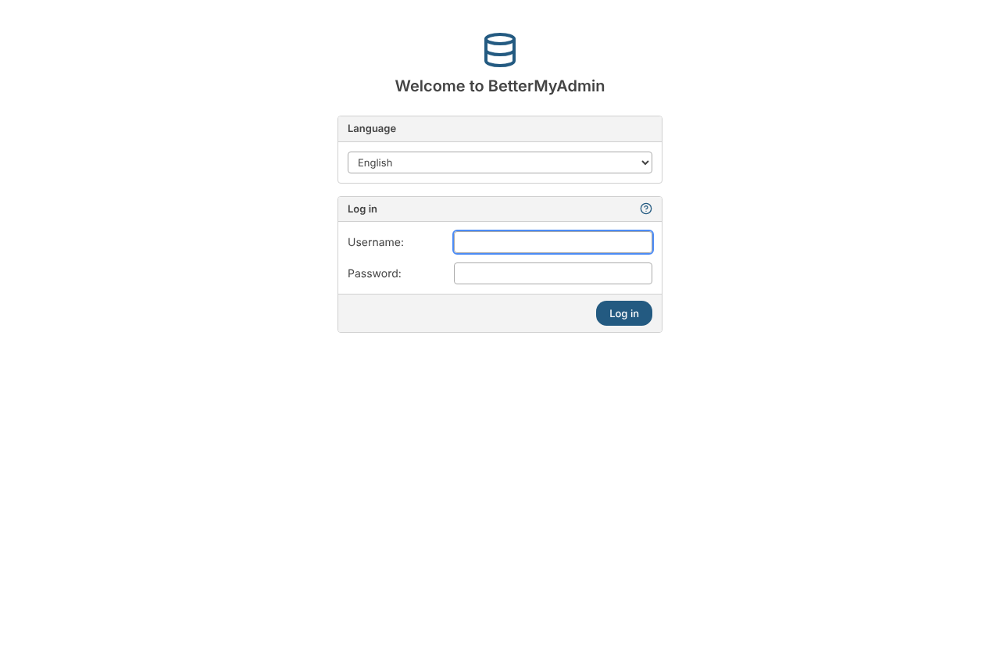
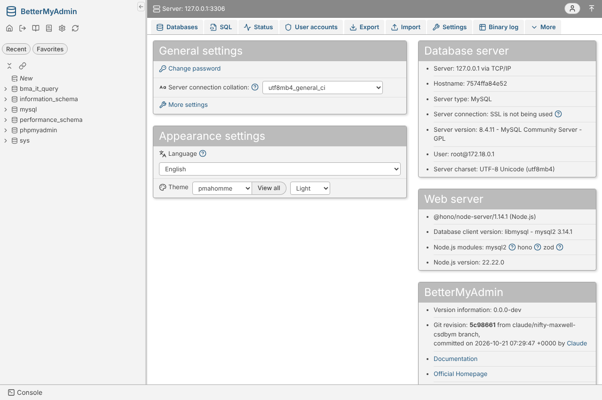
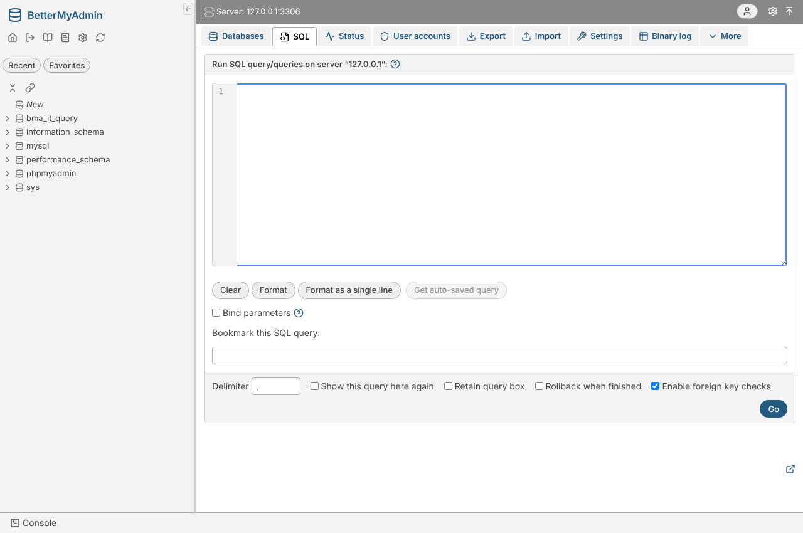
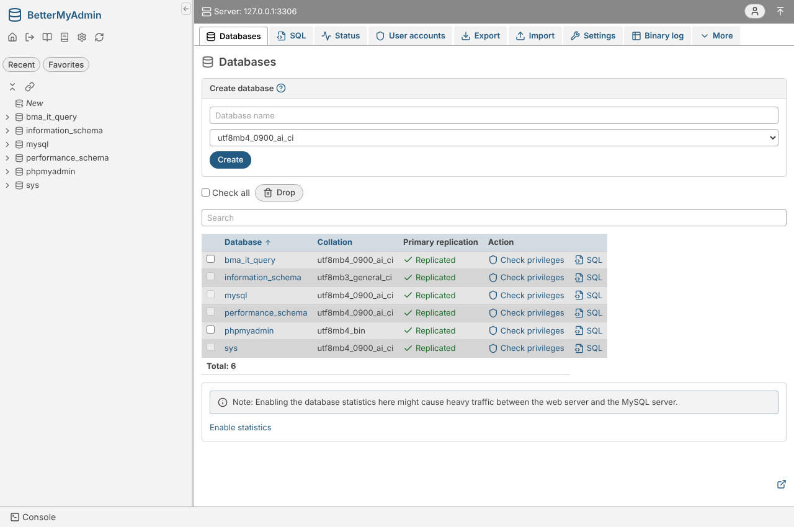

# BetterMyAdmin

A feature-for-feature rebuild of [phpMyAdmin](https://github.com/phpmyadmin/phpmyadmin) in TypeScript and React with a modern UI, specified against phpMyAdmin 6.0.0-dev commit `2c66fc86` ([reference-commit.txt](docs/reference/reference-commit.txt)) and tracked daily against upstream.

Status: a port of every phpMyAdmin 6.0.0-dev feature area, checked against a running phpMyAdmin on MySQL 8.0/8.4 and MariaDB 10.11/11.4 by golden parity tests. [Coverage](docs/reference/coverage/README.md): routes 100%, template controls 100%, config directives 100%, messages 100%, JS behaviours 100%; feature checklist 100% (707 of 707 items). It is a faithful, well-tested port, not yet independently reviewed or run against production data — treat it as a strong beta. See the [roadmap](docs/architecture/13-roadmap-and-milestones.md).

## Screenshots

Running against MySQL 8.4 (home page shows the live server, database tree, and git revision):

| Login | Home |
|---|---|
|  |  |

| SQL editor | Databases |
|---|---|
|  |  |

## Parity

Every feature is specified against one phpMyAdmin commit and verified automatically, so "feature-for-feature" is a measured claim, not a slogan:

- **Inventories** are extracted from the phpMyAdmin reference checkout — its routes, Twig template controls, config directives, translation msgids, and JavaScript AJAX behaviours — and every one is mapped to our implementation or to a recorded [exception](docs/reference/parity-exceptions.md). `pnpm parity:check` gates this on every push; current coverage is 100% on all five dimensions plus the 707-item feature [checklist](docs/reference/coverage/checklist.md).
- **Golden parity tests** (`pnpm test:parity`, `pnpm test:ui-parity`) open the same page or run the same request in a live phpMyAdmin and in BetterMyAdmin and compare them byte-for-byte (exports, SQL output, error messages) or control-for-control (every visible button, input, and link). These run nightly against the real reference; the deterministic suites (unit, integration on four database versions, e2e, UI-parity) run on every push.
- **Upstream is tracked daily**: a routine classifies each new phpMyAdmin commit, ports behaviour changes, and records a decision for every commit in a [ledger](tools/upstream/ledger.json), so the pin only moves forward with a decision for everything it skips.

Intentional differences from phpMyAdmin (a session-id-only cookie instead of an encrypted-password cookie, rate limiting on by default, charset conversion that reports a clean error where phpMyAdmin raises a PHP fatal, and so on) are each listed with their rationale in the [parity exceptions register](docs/reference/parity-exceptions.md).

Start with [docs/README.md](docs/README.md), then [docs/00-vision-and-principles.md](docs/00-vision-and-principles.md) and [development setup](docs/architecture/14-development-setup.md).

```bash
pnpm install
docker compose -f docker/dev.compose.yml up -d mysql84   # MySQL 8.4, root/root on :3306
pnpm --filter @bettermyadmin/web build
BMA_HOST=127.0.0.1 pnpm --filter @bettermyadmin/server start   # http://127.0.0.1:8080
```

Until a configuration file (`bettermyadmin.config.json`, `.ts`, …) exists, the setup script at `/setup` is open without a login, as phpMyAdmin's `setup/` is; the server prints a warning at start. Write a configuration file before exposing the server ([security](docs/architecture/07-security.md#authentication)).

## Install and run

BetterMyAdmin is one Node.js process (Node 22.5 or later) that serves the web app and its API. It connects to MySQL or MariaDB the way phpMyAdmin does; it needs no PHP and no web server in front of it.

### Docker

```bash
docker build -t bettermyadmin .
docker run -d -p 8080:80 -e PMA_HOST=mysql.example.org -v bma-data:/var/lib/bettermyadmin bettermyadmin
```

or `docker compose up -d` with the example [docker-compose.yml](docker-compose.yml) (BetterMyAdmin and MySQL 8.4), then open http://localhost:8080.

The image takes the [official phpMyAdmin image's variables](https://hub.docker.com/_/phpmyadmin), so a compose file written for `phpmyadmin` works with the image swapped:

| Variable | Effect |
|---|---|
| `PMA_HOST`, `PMA_PORT`, `PMA_VERBOSE` | the server to log in to (default: the linked `db`) |
| `PMA_HOSTS`, `PMA_PORTS`, `PMA_VERBOSES` | several servers, comma-separated |
| `PMA_SOCKET`, `PMA_SOCKETS` | socket servers |
| `PMA_ARBITRARY=1` | the login form can name any server |
| `PMA_USER`, `PMA_PASSWORD` | config authentication (no login form) |
| `PMA_ABSOLUTE_URI` | the public URL behind a reverse proxy |
| `PMA_PMADB`, `PMA_CONTROLHOST`, `PMA_CONTROLPORT`, `PMA_CONTROLUSER`, `PMA_CONTROLPASS` | configuration storage and its control user |
| `PMA_QUERYHISTORYDB`, `PMA_QUERYHISTORYMAX` | SQL history in the configuration storage |
| `PMA_UPLOADDIR`, `PMA_SAVEDIR` | server-side import and export directories |
| `PMA_SSL`, `PMA_SSL_VERIFY`, `PMA_SSL_CA`, `PMA_SSL_KEY`, `PMA_SSL_CERT` (also the plural lists and the `*_BASE64` forms, written to `PMA_SSL_DIR`) | TLS to the MySQL server |
| `UPLOAD_LIMIT` | the largest upload, e.g. `64M` (BetterMyAdmin's default is 512M) |
| `MAX_EXECUTION_TIME`, `MEMORY_LIMIT` | `ExecTimeLimit`, `MemoryLimit` |
| `APACHE_PORT` | the port inside the container (default 80) |
| `PMA_USER_FILE`, `PMA_PASSWORD_FILE`, `PMA_HOST_FILE`, … | the same values read from Docker secrets |

`PMA_CONFIG_BASE64`, `PMA_USER_CONFIG_BASE64` and `/etc/phpmyadmin/conf.d` hold PHP code and are not read; use a configuration file instead (below). The image keeps its sessions, the generated `blowfish_secret` and its local metadata in the `/var/lib/bettermyadmin` volume, runs as the unprivileged `node` user, and listens on port 80 inside the container; Docker 20.10 and later let an unprivileged process bind ports below 1024 inside a container, and on other runtimes set `APACHE_PORT=8080`.

Building behind a TLS-intercepting proxy: `docker build --secret id=ca,src=/path/to/ca.pem -t bettermyadmin .`.

### From a checkout

```bash
pnpm install --frozen-lockfile
pnpm build                      # the web app (apps/web/dist)
pnpm start                      # http://127.0.0.1:8080
```

`pnpm start` runs `node apps/server/bin/bettermyadmin.mjs`, which takes `--config <file>`, `--host`, `--port` and `--static <dir>`. The server runs from its TypeScript sources through tsx's loader: there is no separate server build. Configuration files are looked up in the working directory.

### Configuration

Settings come from four layers, each overriding the one before:

1. the defaults: every phpMyAdmin directive under its phpMyAdmin name, with phpMyAdmin's default ([reference](docs/reference/config-directives.md));
2. the phpMyAdmin image's variables above;
3. a configuration file: `--config <file>`, the `BMA_CONFIG` variable, or the first of `bettermyadmin.config.ts`, `.js`, `.mjs`, `.json`, `.yaml`, `.yml` in the working directory (`/etc/bettermyadmin` in the image);
4. `BMA__<Directive>[__<Sub>…]` environment variables (`BMA__Servers__1__host=db`, `BMA__MaxRows=50`, `BMA__Export__format=csv`), plus the shortcuts `BMA_HOST`, `BMA_PORT`, `BMA_USER`, `BMA_PASSWORD`, `BMA_ARBITRARY_SERVER`, `BMA_ABSOLUTE_URI`.

The file holds what `config.inc.php` holds, as data: `$cfg['X']` becomes `X`, and `$cfg['Servers'][$i]` becomes the entries of a `Servers` list (server 1 first). An unknown directive or an invalid value stops the server with a message naming the closest directive.

```jsonc
// bettermyadmin.config.json
{
  "blowfish_secret": "a 32-byte or longer random string",
  "Servers": [
    { "host": "db.example.org", "port": 3306, "auth_type": "cookie" },
    { "host": "replica.example.org", "verbose": "Replica", "controluser": "pma", "controlpass": "secret", "pmadb": "phpmyadmin" }
  ],
  "MaxRows": 50,
  "Export": { "format": "csv" },
  "Listen": { "host": "0.0.0.0", "port": 8080 },
  "DataDir": "/var/lib/bettermyadmin"
}
```

A TypeScript file is compiled as an ES module wherever it sits (no `package.json` needed; top-level `await` and relative imports work), and `import { defineConfig } from '@bettermyadmin/config'` resolves to BetterMyAdmin's own package, in the image too; it gives type checking and completion over every directive in an editor that resolves the package (a checkout).

```ts
// bettermyadmin.config.ts
import { defineConfig } from '@bettermyadmin/config'

export default defineConfig({
  Servers: [{ host: 'db.example.org', auth_type: 'cookie' }],
  MaxRows: 50,
})
```

Directives of BetterMyAdmin's own (not in phpMyAdmin): `Listen` (`host`, `port`, `basePath`), `DataDir` (sessions, the generated secret, the local metadata store; default `~/.bettermyadmin`), `MaxUploadSize`, `SessionStore` / `RedisUrl`, `LoginRateLimit`, `ForceSSL`, `TransformationsExternalPrograms` and the others flagged `bma: true` in [packages/config/src/schema.ts](packages/config/src/schema.ts). Without a `blowfish_secret`, one is generated into `DataDir` on the first start.

Until a configuration file exists, the setup script at `/setup` is open without a login, as phpMyAdmin's `setup/` is (the image ships an empty one, so it is closed there).

### Smoke test

`pnpm test:smoke` builds, starts the production server from a scratch directory with a configuration file, logs in to MySQL (`BMA_TEST_HOST`/`BMA_TEST_PORT`, root/root) and browses a table; `pnpm test:smoke:docker` does the same with the Docker image configured by `PMA_*` variables only (`BMA_SMOKE_BUILD_ARGS` adds `docker build` arguments).
