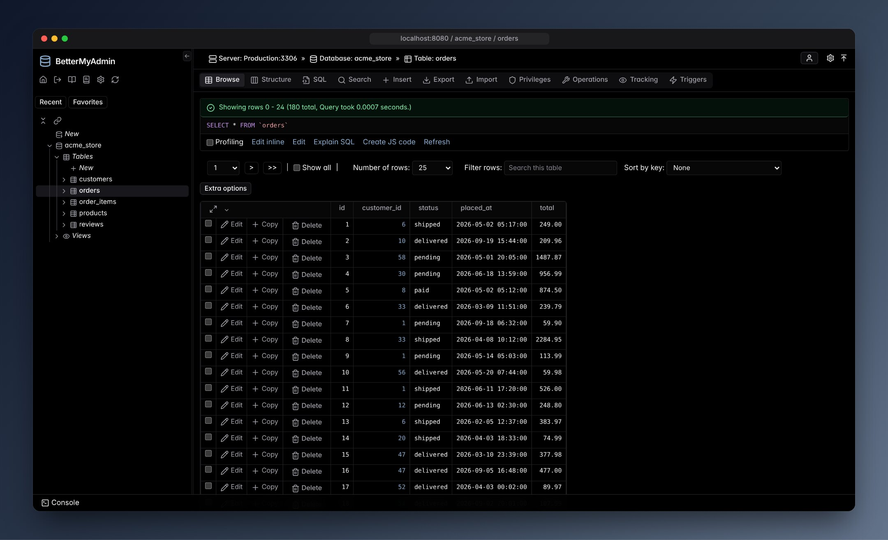
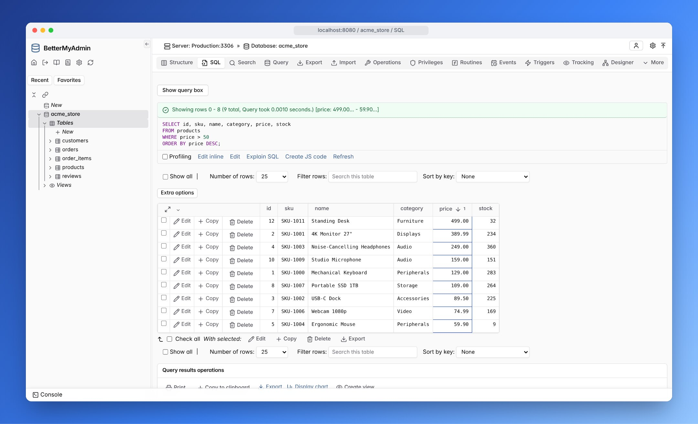
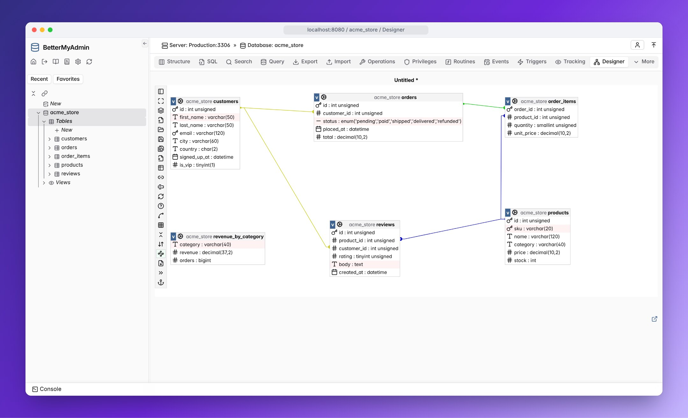
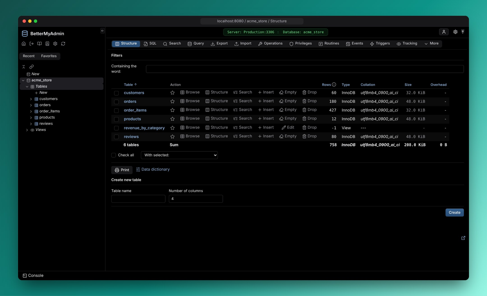
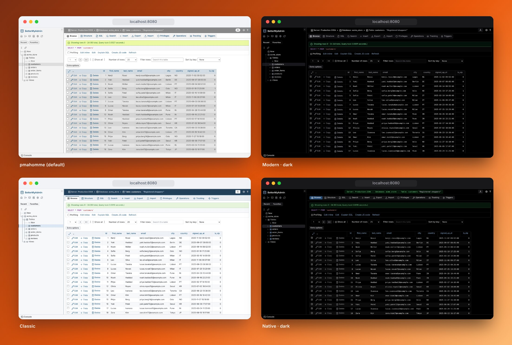

<div align="center">

# BetterMyAdmin

**phpMyAdmin, rebuilt for today.** Every feature you know, in a fast TypeScript and React app.<br>
No PHP, no Apache: one Node.js process or one Docker image.

[](https://github.com/cB-Sigma/better-myadmin/releases)
[](https://github.com/cB-Sigma/better-myadmin/pkgs/container/better-myadmin)
[](https://cb-sigma.github.io/better-myadmin/)
[](LICENSE)

[**Documentation**](https://cb-sigma.github.io/better-myadmin/) ·
[Install](https://cb-sigma.github.io/better-myadmin/setup.html) ·
[Configuration](https://cb-sigma.github.io/better-myadmin/config.html) ·
[Changelog](CHANGELOG.md)



</div>

## Quick start

```bash
docker run -d -p 8080:80 -e BMA_HOST=mysql.example.org ghcr.io/cb-sigma/better-myadmin:latest
```

Open http://localhost:8080 and log in with your MySQL or MariaDB account. Already running the
`phpmyadmin` image? Swap the image name and keep your `PMA_*` variables, because both naming
schemes work ([variables](https://cb-sigma.github.io/better-myadmin/setup.html#docker-vars)).

## Why BetterMyAdmin

|     |     |
|-----|-----|
| ⚡ **Fast** | A single-page app with a virtualized grid and pooled connections. Pages switch instantly and large tables scroll smoothly. |
| 🧩 **Complete** | Browse, search, insert and edit, structure, SQL editor and console, import and export, the designer, privileges, replication, status, routines, events and triggers. It covers all of phpMyAdmin, [measured](docs/parity.md) against 707 checklist items. |
| 🔁 **Drop-in** | phpMyAdmin's pages, settings, configuration storage and Docker variables. Converting an existing `config.inc.php` takes one command. |
| 🎨 **Good-looking** | phpMyAdmin's themes plus Modern, Classic and Native, each with light and dark modes. |
| 🔒 **Safer defaults** | Session-id-only cookies, login rate limiting, and no PHP to patch. |
| 📦 **Simple to run** | One process and one port, with sessions in SQLite or Redis. Runs on Node 22.5+, or from the Docker image. |

<table>
<tr>
<td width="50%"><br><sub><b>SQL editor:</b> highlighting, autocomplete, inline-editable results</sub></td>
<td width="50%"><br><sub><b>Designer:</b> tables, foreign keys and the visual query builder</sub></td>
</tr>
<tr>
<td width="50%"><br><sub><b>Structure:</b> every table at a glance, with bulk actions</sub></td>
<td width="50%"><br><sub><b>Themes:</b> pmahomme (default), Modern, Classic, Native, light and dark</sub></td>
</tr>
</table>

## Learn more

- **[Installation](https://cb-sigma.github.io/better-myadmin/setup.html)**: Docker, Docker Compose, running from a checkout, and reverse proxies
- **[Configuration](https://cb-sigma.github.io/better-myadmin/config.html)**: every directive, configuration files, `BMA__*` environment variables, Redis sessions
- **[Migrating from phpMyAdmin](https://cb-sigma.github.io/better-myadmin/setup.html#manually-creating-the-file)**: `bettermyadmin import-pma-config config.inc.php`
- **[Security](docs/architecture/07-security.md)**: put it behind TLS and a configuration file before exposing it
- **[How parity is measured](docs/parity.md)**: inventories, golden tests against a live phpMyAdmin, daily upstream tracking
- **[Development](docs/architecture/14-development-setup.md)**: building, testing and releasing

## License

GPL-2.0-or-later, like phpMyAdmin, from which BetterMyAdmin is derived. See [LICENSE](LICENSE).

<sub>BetterMyAdmin is an independent project and is not affiliated with or endorsed by the phpMyAdmin project. The name "phpMyAdmin" is used only to describe compatibility.</sub>
