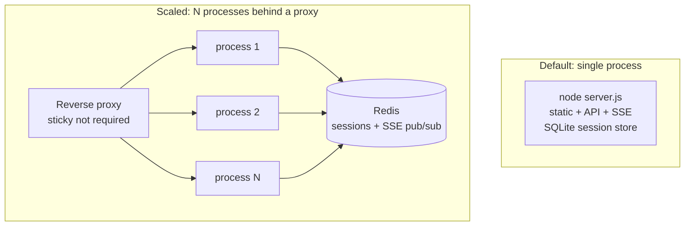
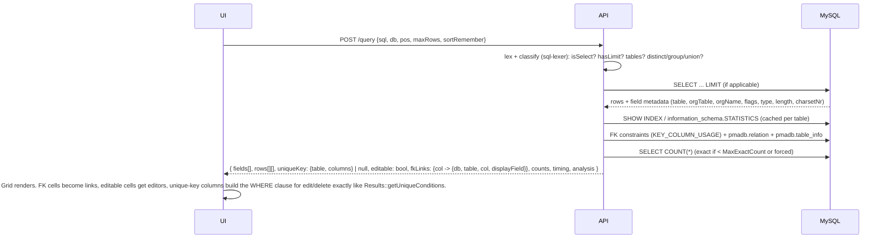

# System architecture

## Bird's-eye view

```mermaid
flowchart LR
  subgraph Browser
    SPA[React SPA<br/>TanStack Router + Query<br/>shadcn/ui]
    W[Web workers<br/>SQL lexer · lint · CSV parse]
    SPA <--> W
  end

  subgraph "BetterMyAdmin server (Node 22 / Bun)"
    Static[Static asset server<br/>(immutable hashed bundles)]
    API[Hono API<br/>/api/*  JSON · SSE · streams]
    Auth[Auth plugins<br/>cookie · config · http · signon · 2FA]
    Sess[(Session store<br/>SQLite or Redis<br/>encrypted credentials)]
    Pool[Connection manager<br/>one mysql2 pool per session×server<br/>KILL via control conn]
    Meta[Metadata service<br/>pmadb reader/writer<br/>+ SQLite fallback]
    Exp[Export/Import engines<br/>streaming plugins]
    API --> Auth --> Sess
    API --> Pool
    API --> Meta
    API --> Exp --> Pool
    Meta --> Pool
  end

  subgraph "MySQL / MariaDB servers (1..n, from config)"
    DB1[(server 1<br/>user databases)]
    PMADB[(pmadb<br/>configuration storage)]
  end

  SPA -- "HTTPS: HTML/JS once, then JSON" --> Static
  SPA -- "fetch / EventSource" --> API
  Pool --> DB1
  Pool -- "controluser" --> PMADB
```

One process serves both the static SPA and the API. There is no PHP, no Apache config, no `config.inc.php` to place in a web root; configuration is a `bettermyadmin.config.ts|json` file or environment variables (see [Data and metadata model](06-data-and-metadata-model.md#server-configuration)).

## The three scopes

phpMyAdmin's information architecture is three nested scopes, each with its own tab bar. We keep it exactly.

| Scope | URL prefix (UI) | API prefix | phpMyAdmin equivalent |
|---|---|---|---|
| Server | `/s/:server` | `/api/servers/:server` | `route=/server/*`, `?server=N` |
| Database | `/s/:server/db/:db` | `/api/servers/:server/databases/:db` | `route=/database/*&db=` |
| Table | `/s/:server/db/:db/t/:table` | `/api/servers/:server/databases/:db/tables/:table` | `route=/table/*&db=&table=` |

`:server` is the 1-based index into the configured servers list, the same number phpMyAdmin uses in `?server=`. Multi-server setups show the server selector in the navigation panel exactly where phpMyAdmin puts it (`NavigationDisplayServers`).

## Request lifecycle: a page view

Walking through "user clicks a table in the navigation tree":

1. **Hover** on the tree item fires TanStack Router `preload: 'intent'`: the route loader for `/s/1/db/shop/t/orders` (Browse, because `NavigationTreeDefaultTabTable` defaults to `/sql`) starts. The loader calls `queryClient.ensureQueryData` for `table.browse({db, table, pos:0, ...})`, which hits `POST /api/servers/1/query` with the default browse query (`SELECT * FROM `orders``) and `GET .../tables/orders/meta`.
2. **Click** navigates. The route component renders with whatever is cached; if the preload is still in flight, the previous page stays visible and a thin progress bar shows at the top (phpMyAdmin shows its "Loading..." badge; we keep the badge too, bottom-right, after 300 ms).
3. **Server:** middleware chain (below) authenticates the session, resolves the pool for server 1, runs the query with `LIMIT 25` appended (unless the statement already has one, see the [query pipeline](../features/09-sql-editor-query-pipeline.md)), runs `SELECT COUNT(*)` for the total (or uses approximate counts above `MaxExactCount`), reads metadata for every result column (type, flags, is it a key, FK targets from `information_schema` merged with `pmadb.relation`, display field, MIME transformation, column comment), and returns one JSON payload: rows, fields, analysis flags, counts, timing, the SQL actually executed, and the "query result operations" the UI may show.
4. **Client** renders the grid from that payload. The nav tree marks the table current (`NavigationLinkWithMainPanel`), the breadcrumb updates, the document title follows `TitleTable` placeholders, the Console records the query in history.
5. **Background:** Query invalidates nothing on a read. The route's `beforeLoad` already prefetched the *tabs* bar's cheap metadata (does the table have triggers? is it a view? which tabs are allowed for this user group), so the tab bar never pops in late.

Compared with phpMyAdmin: same number of SQL statements on the server, one HTTP request instead of one, zero HTML parsing, and the request started on hover.

## Request lifecycle: a mutation

"User drops a column from the Structure tab":

1. Click **Drop** → confirmation dialog with phpMyAdmin's exact text, unless `Confirm` is false.
2. `POST /api/servers/1/databases/shop/tables/orders/columns/drop` with `{columns:['legacy_flag']}`. The server generates `ALTER TABLE `orders` DROP `legacy_flag`;`, runs it, returns `{sql, message, affectedRows}`.
3. Client shows the green success message with the SQL and the `[Edit inline] [Edit] [Create PHP code]` links exactly like phpMyAdmin's `Generator::getMessage`, and invalidates: `table.structure`, `table.browse*`, `table.meta`, `navigation.tableChildren(orders)` (columns under the tree node), `database.structure` (size/overhead), `centralColumns` if the column was central.
4. If `pmadb.tracking` is active for the table, the server appends to the tracking log before returning (same as `Tracking::handleQuery`).

## Server middleware chain

phpMyAdmin runs 32 PSR-15 middlewares in a fixed order (`src/Http/Middleware/*`). We keep the responsibilities, merged into fewer layers:

| BetterMyAdmin middleware | phpMyAdmin middleware(s) folded in | Notes |
|---|---|---|
| `requestId` + `errorHandling` | ErrorHandling, OutputBuffering | JSON error envelope `{error:{code,message,mysqlErrno?,docUrl?}}` |
| `configLoading` | ConfigLoading, ConfigErrorAndPermissionChecking, ServerConfigurationChecking, PhpSettingsConfiguration, PhpExtensionsChecking, DatabaseServerVersionChecking | Config is parsed once at boot and validated with Zod; permission check on the config file mode kept (`CheckConfigurationPermissions`) |
| `session` | SessionHandling, LoginCookieValiditySetting | Session id cookie, sliding expiry = `LoginCookieValidity` |
| `languageAndTheme` | LanguageLoading, LanguageAndThemeCookieSaving, ThemeInitialization | Server only records choices; rendering is client-side |
| `csrf` | TokenRequestParamChecking | Double-submit token header `X-BMA-Token` on every non-GET; GET must be side-effect free |
| `auth` | Authentication, UriSchemeUpdating, UrlRedirection, SetupPageRedirection | Plugin chosen by `Servers[i].auth_type` |
| `currentServer` | CurrentServerGlobalSetting, UrlParamsSetting | Resolves `:server` → config + pool |
| `scope` | DatabaseAndTableSetting, RecentTableHandling, MinimumCommonRedirection | Validates `:db`/`:table` exist (or 404 with phpMyAdmin's "No databases"/"table doesn't exist" messages), records recent table |
| `queryParams` | EncryptedQueryParamsHandling, SqlQueryGlobalSetting, SqlDelimiterSetting, StatementHistory | Signed `sql_query` links, delimiter, history append |
| `userPrefs` | UserPreferencesLoading | Loads merged prefs (defaults ← config ← pmadb userconfig ← per-request overrides) |
| `profiling` | ProfilingChecking | `SET profiling=1` on request when the user toggled profiling |
| `routing` | RouteParsing, ResponseRendererLoading | Hono router |
| (client) | RequestProblemChecking | `post_max_size` style problems become a 413 with phpMyAdmin's message |

## Processes and deployment shapes



The default is a single process, suitable for the overwhelmingly common "one admin, one server" use. Export/import streams and SSE monitors are per-request and need no shared state. With Redis sessions any process can serve any request.

## Component map (packages)

```
apps/
  web/            React SPA (TanStack Router file routes, feature folders)
  server/         Hono API + static serving + CLI entry (`bettermyadmin`)
packages/
  contracts/      Zod schemas + TS types for every endpoint; the only place request/response shapes live
  sql-lexer/      Port of phpmyadmin/sql-parser lexer, contexts (MySQL 5.7/8.x, MariaDB), statement classifier
  sql-gen/        SQL generation: quoting, ALTER/CREATE builders, export SQL writer, where-clause builder for row ops
  mysql-types/    The type catalog (Types.php), attributes, function lists per type, default-value rules, charsets
  metadata/       pmadb reader/writer (relations, display fields, column_info, bookmarks, tracking, uiprefs ...)
  export/         Export plugins (sql, csv, excel, json, latex, mediawiki, ods, odt, pdf, phparray, texy, xml, yaml, htmlword, codegen, toon) as streams
  import/         Import plugins (sql, csv, ldi, mediawiki, ods, shp, xml) as streaming parsers
  transformations/ Output + input transformation plugins (shared: option parsing on server, rendering on client)
  i18n/           Lingui catalogues generated from phpMyAdmin .po files
  ui/             shadcn components, dense admin preset, icons, theme tokens
  config/         Config schema (every directive), defaults, loader (file + env), validators
  kbs/            Vendored MariaDB/MySQL knowledge base for doc links and variable descriptions
  testing/        Fixtures: sample databases (sakila, world, pma-edge-cases), golden files
```

Detailed layout and conventions: [Project structure](12-project-structure-and-conventions.md).

## Data flow for "editable" decisions

phpMyAdmin decides server-side whether a result set is editable and how to address a row. We do the same, because it needs field metadata and `SHOW INDEX`/`information_schema` knowledge:



## What runs where

| Concern | Client | Server |
|---|---|---|
| SQL highlighting, autocomplete, lint, statement splitting for preview | yes (worker) | lint fallback endpoint |
| SQL generation for DDL/DML the user triggered | preview only (`Preview SQL` button uses the server's generator for fidelity) | yes, authoritative |
| Deciding editability, keys, FK links | no | yes |
| Row/column counts, approximations | no | yes |
| Transformations (output) | render (image/link/json/hex) | option parsing, binary fetch via wrapper endpoint |
| Transformations (input) | editors (JSON/XML/SQL editor, regex validation preview) | regex validation re-run server-side before write |
| Export | option forms, template CRUD | streaming generation |
| Import | chunked upload, drag/drop, CSV preview | parsing + execution + progress |
| Designer layout | canvas, drag, zoom | persist coords to `table_coords`/`pdf_pages`, schema export |
| Monitor charts | uPlot rendering, ring buffers | SSE feed sampling `SHOW GLOBAL STATUS` at the chosen interval |
| Preferences | form rendering, localStorage mirror | validation, pmadb `userconfig` persistence |
| Themes, language | fully client | remembers choice |
